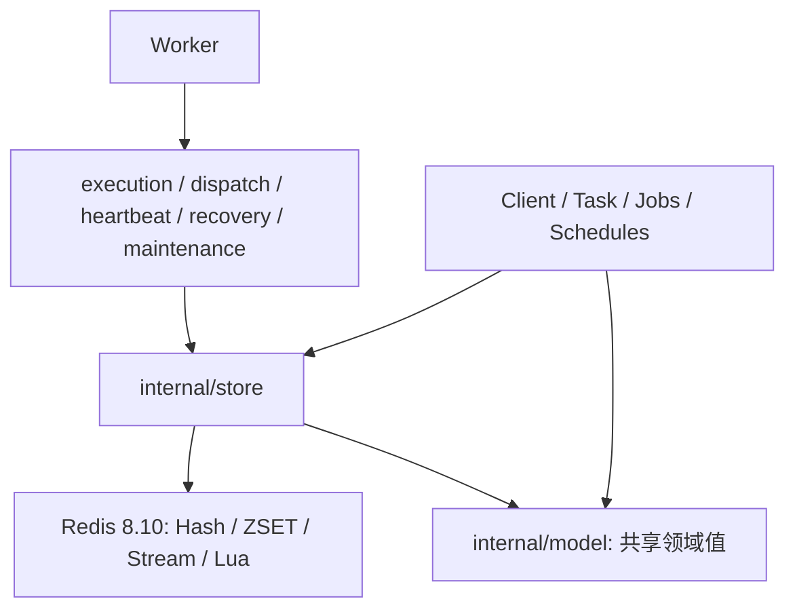

# Redis Scheduler 架构与执行计划

更新日期：2026-11-07。范围：全新设计的 Redis 专用嵌入式调度器，数据协议从 v1 开始，不承担旧方案兼容或迁移，不支持其他后端。

## 目标与边界

以 Redis 8.10 稳定系列最新补丁版为基线。公共 API、运行时、Redis 原子协议三层分离；不引入通用 Repository/Driver。复用已有 Queue 隔离、分页、指标、Cron 缓存、分区和有预算维护实现。

业务执行保证为 at-least-once。Stream 生产幂等、执行 token 和结果回执都不能使外部业务副作用 exactly-once；Handler 必须幂等。Redis 持久化、复制、故障切换的数据安全取决于部署配置，不由 Lua 原子性保证。

## 组件



Client 只持有 clientState：提交限制、管理视图、Cron 缓存、Observer 和 namespace 访问；没有执行注册表、执行槽、活跃任务或停机控制。Worker 独立持有 workerRuntime，负责注册、运行、续租与停机。两者借用 Redis client，但不共享执行引擎。

Jobs、Schedules、Queue 是 Client 的轻量门面，无独立 goroutine。公共 API 保持 Task / Client / Worker / Jobs / Schedules，不暴露 Scheduler、TaskClient 或 Bind。Go 1.27 泛型方法用于 Client.Enqueue/EnqueueBatch、Worker.Register 和 Schedules.Create。

所有 Redis 命令、Pipeline、Lua、Key 和编解码位于 internal/store；公共层只在构造边界接收 redis.UniversalClient。内部适配器使用具体 Namespace/Queue 类型，没有通用存储接口。internal/model 保存共享领域值和错误身份，避免 scheduler 与 store 循环依赖；不包含 Redis 或运行时资源。

### 最终目录

```text
core/scheduler/
├── client.go                 # 公共提交/管理入口
├── task.go                   # 不可变任务定义
├── worker.go                 # 公共注册/运行入口
├── registry.go
├── jobs.go
├── schedules.go
├── lifecycle.go
├── heartbeat.go
├── dispatch.go
├── recovery.go
├── maintenance.go
├── execution.go              # Handler 执行与结果提交策略
├── client_state.go           # 无执行资源的 Client 状态
├── runtime.go                # Worker 独占运行时
├── internal/
│   ├── model/                # 共享领域值，解决 Go 包依赖
│   └── store/
│       ├── store.go          # Redis 访问及能力预检
│       ├── jobs.go
│       ├── execution.go      # Claim / Heartbeat 消息 / Complete / Fail
│       ├── schedules.go
│       ├── delivery.go
│       ├── maintenance.go
│       ├── queries.go
│       ├── history.go
│       ├── keys.go
│       ├── decode.go
│       ├── scripts.go
│       └── lua/
└── metrics/
```

architecture_test.go 检查核心文件存在、Redis 客户端依赖仅出现在构造边界、公共层无 Redis 命令或 Key 访问，并防止重新引入 redis_* 适配文件或 redisproto 包。

## 数据协议 v1

所有同 namespace 的 key 使用 `scheduler:{namespace}:v1:`；Queue 在 hash tag 外。原子范围为一个 namespace，同 namespace 共享 Redis slot，横向扩展通过 PartitionNamespace。这是本架构的初始数据协议，不定义旧方案适配、双读双写或迁移流程。

- Job Hash：任务名、版本、Codec 协议指纹、payload、提交时固化的超时/重试策略/恢复上限、当前状态、attempt、recovery_count、lease_token、lease_until。
- Ready Stream：仅保存 Job ID，是投递记录；Job Hash 是执行状态权威。
- Scheduled ZSET：到期或最晚开始时间；Running ZSET、Dead ZSET 是查询/清理索引。
- Schedule Hash + 索引：固化任务协议及执行策略；occurrence ID 为 `scheduleID:scheduledAt`，CAS 推进下一次时间。停机错过的 occurrence 合并执行一次。
- 提交幂等记录：回执独立于 Job TTL，按 Retention.Submission 窗口保留（默认 24h）；同 ID 不允许跨 Queue/Task/内容复用。
- 完成回执：按 Job + token 保存结果与请求签名，Retention.Completion 独立 TTL（默认 1h）；提交响应丢失后，同请求重放返回同结果，不重复更新状态。
- Attempt：当前执行保存在 Job 中，token 即执行身份。可选历史通过同一转换 Lua 写入每 Job 的有界 List，History.MaxEntries 默认 0（关闭），启用时最多 1000 条，TTL 默认 72h。记录 token、worker、执行次数、开始/结束时间、结果和错误；Jobs.Attempts 返回最新在前。历史独立于 Job TTL，结果回执重放不重复追加，不建立独立 Attempt 实体库。

## 状态机与所有权

`scheduled -> ready -> running -> succeeded/dead/cancelled`；running 失败允许重试到 scheduled；租约失效后允许直接授予新 token。scheduled/ready 超过最晚开始时间到 expired。running 的 expires_at 不强制终止，timeout 约束单次执行。

领取、续租、提交结果必须在 Lua 校验 token/租约。业务失败预算与恢复预算分别限制，同时提供总执行上限。取消 running 设置 cancel_requested；Handler 结束或租约过期后提交 cancelled。旧 token 不得修改新执行结果。Lua 保证无并发插入，不提供运行时错误回滚，因此新命令能力必须在写入之前完成预检。

## 协议身份与策略

Handler 注册键为 Queue + TaskName + Version；同一 Worker 可注册多个版本。同 Queue 消费节点必须支持该 Queue 的全部版本；不同版本支持集合显式使用独立 Queue，不自动派生队列。指纹只包含名称、版本、Codec Identity，不包含 Timeout/Retry 或 Go reflect 类型。Worker 使用 Job 持久化策略，调整 Worker 本地默认值不改变积压任务。

内置重试策略可序列化；自定义策略必须提供稳定 Identity 并在 Worker 注册同一实现，不能用未导出字段的 JSON 作为策略身份。未注册策略不允许静默使用其他策略。

## Redis 新功能

- XACKDEL DELREF：在结果提交 Lua 内确认并清理单执行组消息。
- XREADGROUP CLAIM：统一新消息读取与 Pending 重投递；MAXCOUNT/MAXSIZE 限制返回条数及 Stream 响应大小。大 payload 仍由 MaxPayloadBytes 和执行容量约束。
- XNACK SILENT：停机交还未执行消息；释放前原子校验消息所属 consumer，不能交还已被其他节点接管的投递。
- XADD IDMP：按 Job 执行轮次产生投递幂等 ID，避免重试轮次被错误去重；业务唯一提交仍由 Lua 与独立幂等记录负责。
- 保留独立的受预算 XAUTOCLAIM 扫描作为公平性兜底，避免忙队列的新消息读取或 CLAIM 扫描策略造成 Pending 饥饿。Redis 命令不直接进入 worker。

## 执行容量、超时与停机

每 Queue 独立 Worker 容量。Handler 忽略 Context 时仍占执行槽，直到退出或 Worker 终止；不得无限补开 goroutine。停机先停止接收，交还未执行消息，在途任务继续续租；超过 ShutdownTimeout 取消，结束等待受 OperationTimeout 约束。Go 无法强杀 Handler。

普通 Redis 操作继承父取消且有 OperationTimeout；停机结果提交使用独立有界 Context。阻塞接收按 PollTimeout 单独设期限。心跳按固定块发送；续租失败采取保守取消，不在结果未知时推测续租成功。

## 公共 API

```go
client, err := scheduler.NewClient(redisClient, scheduler.ClientConfig{Namespace:"app"})
worker, err := scheduler.NewWorker(redisClient, scheduler.WorkerConfig{Namespace:"app"})
task, err := scheduler.NewTask[Payload]("task.name")
err = worker.Register(task, handler)
job, err := client.Enqueue(ctx, task, payload)
schedule, err := client.Schedules().Create(ctx, task, payload, spec)
err = worker.Run(ctx)
```

ClientConfig 仅包含提交、管理与连接预算；WorkerConfig 包含 Queue 执行容量和后台角色配置。构造不访问 Redis，第一次提交或 Run 预检能力。

## 执行计划与验收

- [x] P1：v1 协议、Redis 8.10 能力预检、XACKDEL、接收预算、IDMP 与安全交还。真实 Redis 验证新命令、PEL 清理、拒绝旧版本。
- [x] P2：任务版本路由、协议指纹、持久化执行策略与自定义策略标识。验证多版本并存、积压任务策略稳定、Codec 不兼容拒绝。
- [x] P3：业务/恢复/总执行预算、原子 Claim 终结与幂等提交/结果回执。验证连续崩溃、超限清理、响应丢失重放及不同请求冲突。
- [x] P4：容量、超时、心跳分块与停机。验证忽略取消的 Handler 不突破容量、未执行消息交还、在途排空、故障隔离。
- [x] P5：文档、示例、故障测试、race/vet/全仓测试和并发基准。记录实际结果、环境限制，不以跳过集成测试冒充通过。

各阶段按顺序执行，变更失败先修复再推进。保留调用方未提交改动，不提交或部署。

## 官方依据

- https://redis.io/docs/latest/operate/oss_and_stack/install/version-mgmt/
- https://redis.io/docs/latest/commands/xreadgroup/
- https://redis.io/docs/latest/commands/xackdel/
- https://redis.io/docs/latest/commands/xnack/
- https://redis.io/docs/latest/develop/data-types/streams/idempotency/

## 验证记录

本次实现与验证已完成，公共名称保持 Task / Client / Worker / Jobs / Schedules；数据协议为 v1。没有引入通用存储框架。

| 检查 | 结果 |
|---|---|
| 真实 Redis 8.10.0 集成测试 | 通过，强制要求 Redis 可用，没有以跳过代替验证 |
| `go test -race ./core/scheduler/... -count=3` | 通过，最终 scheduler 用时 23.429s |
| `go vet ./core/scheduler/...` | 通过 |
| `git diff --check` | 通过 |
| `go test ./...` | 已执行；scheduler 通过，未改动的 transport/http/middleware 有 3 项 Crypto 测试失败 |

故障测试包括：公开 Client/Worker 的真实子进程强杀与替换恢复、不同 token 隔离、连续恢复耗尽、业务/总执行预算、服务端完成提交但响应实际丢失后的幂等重放、Job 删除后的提交回执、冲突请求、XREADGROUP CLAIM 恢复识别、XNACK 的 consumer 校验、停机交还缓冲、超时 Handler 实际容量以及 600 项心跳的 256 条分块。

全仓未通过项目：TestCrypto_Success、TestCrypto_InvalidBase64、TestCrypto_Gin。它们位于本次未修改的 HTTP 中间件，不属于 scheduler 重构范围，没有为通过验收修改无关代码。

### 性能基线

环境：Linux amd64，Intel i9-12900K，Go 默认 GOMAXPROCS=24，本地 Redis 8.10.0。单次 `-benchtime=200ms -count=1`，同时存在其他验证负载，仅作功能与性能回归基线，不作为重构前后优劣结论。

| 场景 | jobs/s | 分配 bytes/op | 分配 allocs/op |
|---|---:|---:|---:|
| 并发公共 Client/Worker 往返 | 1,843 | 22,665 | 244 |
| 串行短任务 | 798.0 | 15,406 | 233 |
| 串行 5ms Handler | 113.2 | 15,188 | 233 |
| 串行 256 KiB Payload | 99.35 | 1,847,085 | 252 |
| 串行 8 Queue 往返 | 769.5 | 15,286 | 232 |

并发场景 P95=32.69ms、P99=44.83ms，计量到 Handler 返回，不包含最终 Redis 状态提交。串行场景覆盖状态提交。该轮尚未验证跨节点、Cluster 故障切换和重启后持久性（后续隔离验证结果见文末）；生产比较需独立固定环境、多轮运行并观测 Redis CPU/内存及连接池。

## 严格模块隔离补充验收

- [x] 全部 Redis 适配、Key、Lua、编解码进入 internal/store，移除原 redisproto 包。
- [x] Client 与 Worker 独立状态；Client 不再构造或持有执行运行时。
- [x] worker.go 为公共运行入口，execution.go 与 recovery.go 独立。
- [x] 可选 Attempt 历史完成条数/TTL、恢复、失败、成功、回执重放及实体删除后查询验证。
- [x] 包依赖边界检查、真实 Redis 集成、三轮 race、vet 与全仓检查完成。

本轮验证：Redis 8.10.0 完整集成通过；三轮 race 通过（scheduler 24.266s）；模块 vet、架构边界测试和 diff 检查通过。全仓测试再次执行，scheduler 通过，HTTP middleware 中 TestCrypto_Success、TestCrypto_InvalidBase64、TestCrypto_Gin 仍失败，本轮未修改这些文件。

前面的性能数字属于上轮功能实现，不代表本轮分包和可选历史的开销；本轮默认关闭历史，后续比较应固定配置与测试环境。

## 后续实现优化（2026-11-07）

- Worker 的管理视图与执行循环复用同一个 Queue 存储对象，移除重复 queueOrder；队列选项仅在构造时初始化。
- 提交幂等签名先摘要原始 Payload，JSON 元数据只包含固定长度摘要，避免大 Payload 的 base64 临时复制。
- 能力预检成功使用 atomic 快速路径；失败继续允许重试。
- Complete/Fail 共用 Lua 回执读取、回执写入、租约校验和消息确认逻辑；Go 端统一解码结果，未知协议状态返回错误。
- 仅供适配器内部调用的编解码、分页、Pipeline 和签名辅助方法改为私有。
- internal/model 按 job、schedule、policy、query、stats 分文件。
- 构造时要求借用客户端启用 ContextTimeoutEnabled，未启用返回 ErrInvalidArgument，避免虚假的 OperationTimeout 保证；不修改客户端选项。新增无响应 TCP 服务验证真实网络等待的超时边界。

指纹独立基准（200ms）：64B 为 1977 ns/op、1090 B/op、6 allocs/op；256KiB 为 116329 ns/op、1091 B/op、6 allocs/op。仅代表签名计算，不代表完整任务吞吐。完整验证结果见本节后续记录。

本轮验证：Redis 8.10 强制集成三轮 race 通过（24.137s），包括真实无响应网络超时、共享存储实例、幂等重放、取消及恢复；模块 vet 和 diff 检查通过。全仓测试已执行，scheduler 通过，未改动的 HTTP middleware 三项 Crypto 失败仍然存在。

## 可靠性与容量边界补齐（2026-11-07）

- 每次新建 Job 写入独立 incarnation。Stream IDMP 使用 incarnation + generation + attempt，消除复用 JobID 与独立回执/IDMP 窗口交错导致的漏投递。
- Claim 在有效租约内对相同 token + worker 幂等返回原执行快照；相同 token 的不同 worker 不被接受，不额外计数或续租。测试实际注入“服务端成功、响应丢失”。
- 缺少 Handler、Codec 不匹配、自定义策略不匹配统一经过 rejectJob，记录状态提交错误并发送带 CommitErr 的 EventFinished，不再吞掉失败。
- 提交和完成回执分别使用 Submission（默认 24h）和 Completion（默认 1h）保留配置。
- 两个 Worker 加持续新任务负载，验证已有 Pending 能恢复并完成；三轮 race 强制 Redis 集成通过（24.899s）。
- BenchmarkReceiptFootprint：206 B/submission、212 B/completion、2 receipt keys/job；这是 MEMORY USAGE 样本，不含全局管理及其他调度数据。需要结合提交速率、执行速率和各自 TTL 估算容量。
- scripts/verify-redis.sh 提供隔离六节点 Cluster 和 AOF 重启测试，自建容器与卷自动清理。环境测试与普通集成测试分开，避免误操作共享部署。

全仓测试已执行：scheduler 通过，未改动的 HTTP middleware 三项 Crypto 测试仍失败。最终隔离环境验证结果在下文记录。

最终隔离验证通过：六节点 Cluster 的计划切换与主节点退出后的自动切换均成功，提交回执和延迟任务保持可读；AOF 容器重启后，延迟 Job、Schedule、提交回执、完成回执与 Attempt 历史验证通过。脚本返回 0，并已清理自建容器及测试卷。验证以 appendfsync=always 和复制屏障为前提，不等同于证明任意部署配置下零数据丢失。

最终模块 vet、diff 检查、隔离脚本语法检查均通过；代码未提交。
